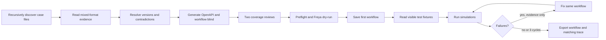
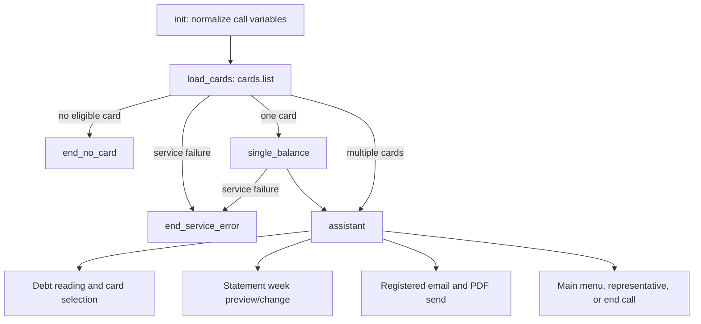

# Freya Build the Builder

An evidence-driven coding-agent harness that turns a bank case folder into a
tested Freya phone-agent workflow. The submitted final agent handles Turkish
credit-card statement debt calls.

## Builder loop



Key features:

- Recursive discovery; no fixed final-case filenames.
- Visual inspection of diagram PDFs, including page rendering when arrows and
  box relationships are lost by text extraction.
- Structural reading of DOCX and XLSX evidence.
- Source-date and authority-aware conflict resolution.
- Blind first workflow write before visible test customers are read.
- Stateful Claude Agent SDK session for generation, testing and evidence-based
  repair of the same workflow.
- At most three fix cycles; failed cases drive changes.
- Generic preflight checks for graph shape, tools, placeholders and OpenAPI
  contracts.
- Sanitized, case-independent lessons only; practice fixtures are not memorized.
- Full session trace: prompt, model calls, tools, tests, IDs, counts and export.

Run:

```sh
python3 builder/build.py {case_folder} {mock_url}
```

## Submitted phone agent



The assistant uses 6 workflow nodes and 19 tools. It covers duplicate card
names/digits, shared statements, statement-day totals, cards without a cut
statement, explicit confirmation before mutations, prompt-injection resistance,
full Turkish currency names and human/main-menu handoffs.

## Bank mock

`builder/build_mock.py` derives a Cloudflare Worker from the service contract
and visible test-customer fixtures. Per-customer mutations use Durable Objects.
The final mock implements seven endpoints and passed 1,426 local
contract/fixture checks before deployment.

## Final run

- Preflight: 0 errors.
- Visible scripted simulations: 10/12 passed.
- The remaining two end-node cases were not scoreable through the text-chat
  route because it returned 504 while ending the call; event/status evidence
  confirmed routing to the intended no-card and service-error nodes.
- The exported workflow and trace in `submission/` come from the same run.
